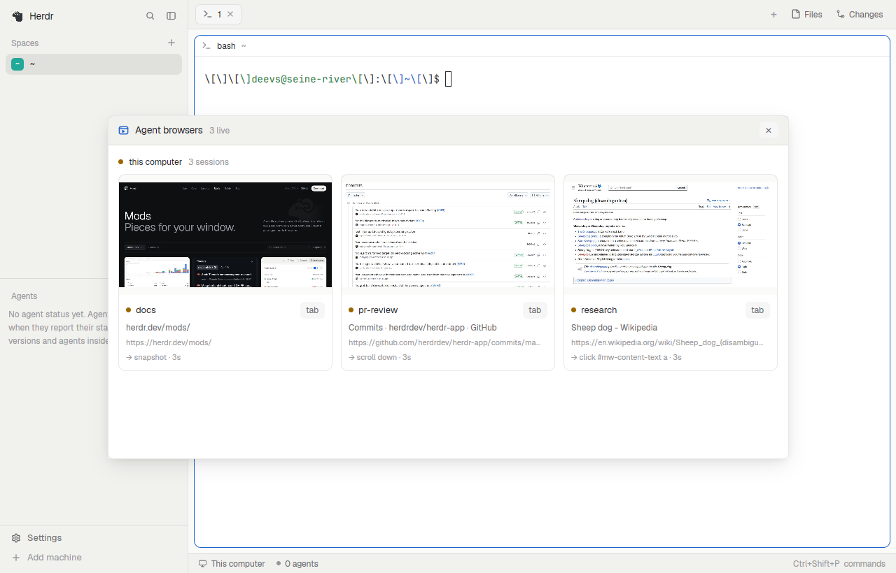

# herdr-agent-browser

A [Herdr](https://herdr.dev) mod for [agent-browser](https://github.com/vercel-labs/agent-browser):
every browser your agents are driving, on this computer and on every machine Herdr is
connected to, live in one window. Open one to watch it closely, follow the agent's
commands, or take the mouse and keyboard yourself.



this computer + every Herdr machine · 1 fps cards · 8 fps session windows · MIT

## Install

```sh
git clone https://github.com/DeevsDeevs/herdr-agent-browser
cp -R herdr-agent-browser/mods/agent-browser ~/.config/herdr-app/mods/
herdr-app check ~/.config/herdr-app/mods/agent-browser
```

Copy the folder rather than symlinking it: Herdr reads mod files from its own folder.

Before you install, what it reaches for: it runs `sh` here and on each of Herdr's
machines (to list sessions), `hc` (machines, tunnels) and `ssh` (one tunnel per remote
session it shows, opened as soon as the overview is). It reads agent-browser's state
folders (`$AGENT_BROWSER_SOCKET_DIR`, `$XDG_RUNTIME_DIR/agent-browser`,
`~/.agent-browser`, `$TMPDIR/agent-browser`, only ones you own). It connects to
`127.0.0.1` only, and writes under `~/.config/herdr-app/mods/agent-browser-frames/` and
`data/agent-browser/`.

## Use

Open it with `mod.open` from the command palette, or give it a key in
`~/.config/herdr-app/keys.json` (`secondary` is Cmd on macOS, Ctrl elsewhere; Herdr ships
nothing on it):

```json
{ "global": { "secondary-shift-y": "mod.open:agent-browser" } }
```

The overview is a window of cards grouped by machine: a live picture of each session, its
title and address, and the agent's last command. Click a card to open the session in a
window of its own, or `tab` on the card to open it as a tab.

| part | what |
|---|---|
| `‹` `›` `↻` | back, forward, reload |
| address bar | follows the page; type an address and Enter to go there |
| `watching` / `controlling` | only watch (the default), or send your clicks, scrolling and typing to the page |
| `↗` | open the page in your own browser |
| `end` | close the session; asks once |
| tab strip | shown when the session has more than one tab; click to switch |
| status line | frame rate and the agent's last command; click it for the last 30 |

While controlling, Cmd-V (Ctrl-V on Linux) types the clipboard into the page and Cmd
shortcuts reach a browser on Linux as Ctrl. Keys Herdr binds itself stay with Herdr.

The log and the cards show where a command went (`click @e3`, `navigate https://…`), never
what was typed; addresses outside the session window lose their query and any
`user:password@`.

## Configure

Everything is in [`settings.js`](mods/agent-browser/settings.js), and every key is optional.

| key | what | default |
|---|---|---|
| `machines` | where to look: `null` for this computer and every connected machine, or a list like `[null, "seine-river"]` | `null` |
| `scanEveryMs` | how often each machine is asked for its sessions | `4000` |
| `cardFps` | frames per second on a card | `1` |
| `viewerFps` | frames per second in a session window | `8` |
| `ssh` | per machine `{ args, target }`, for a machine added with `--via`, or one `ssh <target>` can't reach as is | `{}` |
| `sshBinary` | the ssh to run | `"ssh"` |

## How it works

- **Finding sessions.** One `sh` call per machine lists the live daemons from
  agent-browser's own state files. No agent-browser CLI or PATH needed there.
- **Streaming.** Each session streams its viewport over a WebSocket on its own machine's
  `127.0.0.1`. Here the mod connects directly; for another machine it runs
  `ssh -L … <target> sleep 30` as a herdr-core terminal, which ends by itself when the
  stream it carries closes. Streams run only while the overview or session window is
  drawn, and watching never keeps an idle session alive: only your input counts as
  activity to agent-browser.
- **Shared machines.** agent-browser's stream port takes anyone on `127.0.0.1`, and so does
  a tunnel's local end: on a computer with other users, they can watch and drive a session
  while it streams. Narrow `machines` if that matters.

## Requirements

| what | where | why |
|---|---|---|
| Herdr app newer than 0.1.11 | here | frees each shown picture; 0.1.11 can't, so there you get stills, refreshed on demand |
| herdr-core | here and on each machine | `exec` on other machines, tunnels as terminals |
| agent-browser (tested with 0.41) | wherever agents browse | the session stream |
| macOS or Linux | here and on each machine | `sh`, `kill` and `sleep` find sessions and hold tunnels; no Windows |
| ssh with key login | here, to each other machine | tunnels to remote streams |
| Chrome | wherever agents browse | other engines connect but may send no pictures |

## Troubleshooting

**Cards say pictures are stills.** Your Herdr is 0.1.11, which keeps every picture it ever
showed in memory. The mod shows each session's first frame and updates a session window
on `◉` or after your own input. A newer Herdr, or a build from main, makes them live.

**A remote card shows `Permission denied`, `Host key verification failed` or another ssh
error.** The tunnel runs plain `ssh <target>` with `BatchMode=yes` from your ssh config.
Make `ssh <target> true` work without a prompt, or set `ssh` for that machine in
`settings.js`.

**A remote card shows `Could not request local forwarding`.** Your ssh config's `Host`
entry for that machine has a `LocalForward` (or `DynamicForward`), which the tunnel then
asks for too. Point `ssh` for the machine in `settings.js` at a `Host` without forwards.

**A machine says it is reached through a command.** It was added with `--via`. Tell the
mod how to ssh there with `ssh` in `settings.js`.

**A session shows `no stream`.** Its stream is off (`agent-browser stream enable` turns it
back on) or its daemon predates streaming.

**A session says `the page hasn't painted`.** agent-browser sends a picture only when Chrome
paints. A headed browser whose window is hidden never does, and neither does an idle page
whose viewport changed. Show the window, or do anything on the page.

**Pictures stop while Herdr is minimised or the overview's tab is in the background.** By
design: streams run only while drawn, and come back a few seconds after.

**Clicks land in the wrong place.** Open an
[issue](https://github.com/DeevsDeevs/herdr-agent-browser/issues) with the page size from
`agent-browser eval "[innerWidth, innerHeight, devicePixelRatio]"`.

## Layout

```
mods/agent-browser/
  main.js       the overview and the session window
  stream.js     one session's WebSocket: frames, tabs, url, activity, input
  connect.js    direct, or an ssh -L that ends with the stream
  frames.js     pictures through image(): a new file per frame, swept
  lib.js        discovery script, parsing, coordinates, keys (no imports)
  settings.js   the knobs
  mod.json      opens as a window with mod.open
  icon.svg
```

[`RECIPE.md`](RECIPE.md) is the brief to rebuild it from, and covers what isn't obvious
from the code: why every frame is a new file, why clicks use the JPEG's own size.

## Credits

Built on [Herdr](https://herdr.dev) and Vercel's
[agent-browser](https://github.com/vercel-labs/agent-browser). Installed with a
[chezmoi external](https://www.chezmoi.io/user-guide/include-files-from-elsewhere/) from
[my dotfiles](https://github.com/DeevsDeevs/dotfiles).
