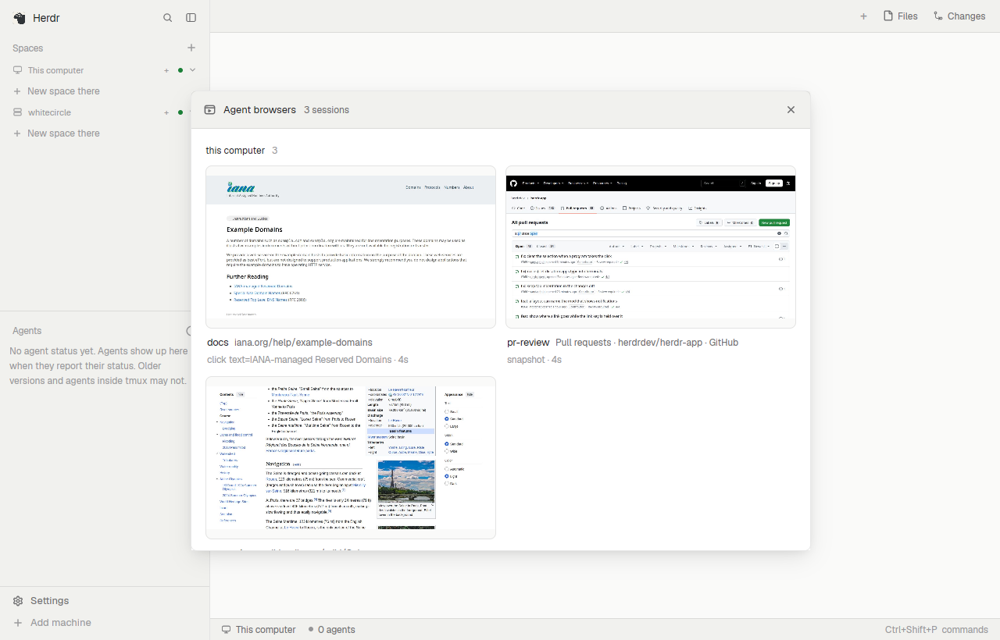

# Agent browser

A window of live cards, one per agent-browser session, grouped by the machine it runs
on: this computer first, then every machine Herdr is connected to. Each card shows the
page as it is right now, its title and address, and the agent's last command. Clicking a
card opens that session in a window of its own: a bigger live picture, an address bar,
back/forward/reload, its tabs, a running log of the agent's commands, and a switch to
take over the mouse and keyboard.

## What you see

**Overview** (`mod.open:agent-browser`, a `window` overlay 62% × 72% of the window).
Lucide icons (`<name>.svg` in the mod folder, `currentColor`), 28px ghost icon buttons
(`muted`, `foreground` on `hover`, with a tooltip), like agent-images:

- A 48px header on `chrome` with a 1px `border` line under it: the mod's icon (15px,
  `muted`), "Agent browsers" (13px semibold), the session count ("2 sessions", 12px
  `muted`), and an `x` icon button on the right when it is an overlay.
- On Herdr 0.1.11, a stills banner under it on `raised`: a camera icon and why pictures
  are stills.
- Below, on `surface`, 18px padding, 22px apart, one section per machine that has
  sessions or needs a look (still being asked, not answering, or unreachable):
  - A line: the machine name ("this computer" for here, 12px semibold) and its session
    count (`dim`). A 7px dot only when the machine needs a look: `idle` while it is still
    being asked or isn't answering, `blocked` when it can't be reached (with the reason).
  - A wrapping row of cards 12px apart. Cards are at least 260px wide and fill the row.
- Machines with nothing running share one `dim` line under the cards: "Nothing running
  on whitecircle, seine-river".
- A card, no box around it:
  - The picture: full card width, 16:9, 8px corners, 1px `border` (`accent` on hover),
    on `canvas`. Until a frame arrives it says why in the middle (11.5px `dim`). On
    hover, an "open as a tab" button (app-window icon, 28px, `popover`) sits in its top
    right corner.
  - Under it: the session name (12.5px semibold), then the page title (12px `muted`,
    truncated), with the host after it only when the title doesn't already name it.
  - A second line (11.5px `dim`): the agent's last command and its age ("click @e3 ·
    4s"). When something is wrong it says that instead ("connecting…", the error in
    `blocked`, "no stream (engine)", or "no picture: the page hasn't painted (hidden
    window or idle page)" 6 s after connecting without a frame), and a status dot comes
    before the name.
- No sessions anywhere: the mod's icon (22px `dim`), "No agent browsers running" (13px
  `muted`) and a hint (12px `dim`), centred.

**Session window** (a `window` overlay 66% × 78%, one per session, or a tab):

- A 48px header on `chrome`: the icon (`muted`), the session name (13px semibold) and
  the machine (12px `muted`); chevron-left, chevron-right and rotate-cw icon buttons for
  back, forward and reload; the address bar (28px, `background`, 1px `border`, 6px
  corners, flexible); a segmented Watch | Control switch (eye and mouse-pointer icons,
  on `raised`, the chosen side on `surface` with a small shadow, the pointer `accent`
  while controlling); a camera button (stills only); external-link; power; `x`.
- Power opens a 44px bar under the header on `raised`: a `blocked` power icon, "End
  `<session>`? Its browser closes for the agent too.", Cancel and "End session"
  (`blocked`). It asks in the window itself: Herdr's `confirm` runs a global command,
  which every open session window would hear.
- A 34px tab strip when the page has more than one tab: titles in 24px pills, the active
  one on `selected`.
- The page picture filling the rest on `canvas`, letterboxed to keep its shape. While
  controlling, a 2px `accent` outline is drawn over its edge.
- A 30px status line on `chrome`: a dot, "live · 8 fps" (or "still", or the stream
  status, `muted`), the agent's last command with its age (`dim`; a failed command of
  yours in `blocked` for 4 s), and on the right "Activity", the count and a chevron.
  Clicking it opens up to 30 commands above it (age, command, duration).

## How it behaves

- A card's dot shows only when something is wrong: `idle` while connecting or when the
  page hasn't painted, `blocked` on an error, `dim` when paused or without a stream. The
  session window's status dot is always there, `working` while streaming.
- Machines are asked for their sessions every 4 s, each on its own: a machine's
  section fills in as soon as it answers ("looking…" until then). Sessions appear and
  disappear on their own; a machine Herdr can't reach shows its state instead of cards.
  One that hasn't answered in 8 s says "not answering for 12s" (`idle` dot) while the
  others carry on, and its stuck call is repeated at most once a minute.
- Cards stream at 1 fps while the overview is drawn, even under another window; an
  overview not drawn for about 10 s stops its streams until it is drawn again. A session
  window does the same at 8 fps.
- The session window streams at 8 fps. In Watch, the picture is all it does. In
  Control, presses (left and right, with double-clicks), pointer moves (at most
  30/s), the wheel and keys go to the page; Cmd/Ctrl-V types the clipboard; on a Linux
  browser, Cmd becomes Ctrl.
- The address bar follows the page until you type in it; Enter navigates. `https://` is
  added unless it starts with `http(s)://`, `about:`, `data:`, `file:` or `chrome://`.
- Back, forward, reload, tab switching and ending are commands to the session's daemon.
- A session that ends says so in its window. A dropped stream reconnects with backoff. A
  new daemon under the same name starts in Watch.
- On Herdr 0.1.11 (it never frees a shown picture) a banner says pictures are stills:
  cards keep their first frame, a session window shows the newest one 0.6, 1.5 and 3 s after
  your input or a navigation, and on the camera button.

## Built from

- One mod, `agent-browser`, used two ways by its props: none for the overview,
  `{view: "viewer", machine, session, dir}` for a session (`openOverlay` with
  `kind: "window"`, `key` per session, or `tab.new {mod, props}`). `mod.json`:
  `{ "place": "none", "title": "Agent browser", "overlay": { "kind": "window", "key": "agent-browser", "width": 0.62, "height": 0.72 } }`.
- Art: `icon.svg`, a 16px browser window outline with two dots and a play triangle,
  stroked in `currentColor` and drawn with `svg()`.
- Controls: Lucide icons saved beside `main.js` (x, chevron-left, chevron-right,
  chevron-up, chevron-down, rotate-cw, external-link, camera, eye, mouse-pointer, power,
  app-window) with `LICENSE-Lucide.txt`, drawn with `svg("mods/agent-browser/<name>.svg")`.
- Read props with `props()`, not `init`'s first argument.
- Sessions: `exec("sh", ["-c", script], {on})` per machine. The script looks where
  agent-browser keeps its state (`$AGENT_BROWSER_SOCKET_DIR`,
  `$XDG_RUNTIME_DIR/agent-browser`, `~/.agent-browser`, `$TMPDIR/agent-browser`, and
  `namespaces/*/run` in each), keeps `<session>.pid` files (not `dashboard.pid`, the dashboard server) whose process is alive in
  folders the user owns, and prints one JSON line per session with its folder, `.stream`
  (port), `.engine` and `.target` (url). A session is machine + folder + name: namespaces
  can reuse a name.
  Machines come from `hc machine ls --json`, skipping `temporary` ones; `via: true`
  means no ssh target.
- Stream: `WebSocket.connect("ws://127.0.0.1:<port>/?maxFps=N")` from the `websocket`
  module, one read loop per stream in `cx.spawn`. Messages: `frame` (base64 JPEG,
  `metadata.deviceWidth`), `tabs`, `url`, `command`, `result`. Input goes back as
  `input_mouse` / `input_keyboard` JSON. Daemon commands are `POST /api/command` on the
  same port with an `Origin` equal to the URL's own origin.
- Remote streams: `hc run --bg --rm --no-parent --no-notify --json --name ab-tunnel-<port>
  --label agent-browser=tunnel -- ssh -o ControlPath=none -o BatchMode=yes
  -o ExitOnForwardFailure=yes -o ConnectTimeout=10 -o ServerAliveInterval=15
  -o ServerAliveCountMax=3 -o LogLevel=DEBUG1 -E <log> -L 127.0.0.1:<port>:127.0.0.1:<remote> <target> sleep 30`,
  with a free port in 20000-31999. It is up when the log says
  `Local forwarding listening on 127.0.0.1 port <port>.`, never `cannot listen to port`,
  and the port answers `net.connect` twice in a row.
- Herdr version: newer than 0.1.11, or the app home's `AGENTS.md` contains
  "Saving an asset under `mods/` updates every", means shown pictures are freed.
- Frames: decode with `Buffer.from(b64, "base64")`, write with `fs/promises.writeFile`
  to `mods/agent-browser-frames/<copy>-<feed>-<time36>-<seq>.jpg`, show it 200 ms later
  with `image()` stacked over the previous one, delete the one before that.
- Page coordinates: the frame's own JPEG size (from its SOF header) scaled to
  `deviceWidth`, then object-fit-contain maths against the element's `bounds`.

## Watch out

- `image()` caches by path and Herdr only clears that cache for paths its watcher sees
  (`mods/`, `layouts/`, `themes/`), never `data/` or hidden files. Writing under the mod's
  own folder reloads the mod. A sibling folder without `main.js` is the spot.
- Hold a new frame's path back for longer than the watcher's 80 ms batch before drawing
  it, and keep the previous frame under it, or the picture flickers.
- `metadata.deviceHeight` is the whole browser window, not the page: a 1280×720 window
  sends 1280×633 frames. Map clicks with the JPEG's own height.
- agent-browser 0.41 sends `success: false` in every `result`; don't show it.
- Commands in the log show their target only (`url`, `selector`, `ref`, `key`,
  `direction`, `tabId`, `index`): typed values and script bodies never appear.
- `fs/promises` reads only under `$HOME` while the app folder may be elsewhere: read ssh
  logs with `readTextFile`.
- A user's `ControlMaster` would carry the forward and outlive the tunnel:
  `ControlPath=none`.
- A release outside the picture never arrives: clamp releases to the page, and send one
  when the pointer leaves during a drag.
- Limits: the log keeps 40 commands and shows 30; a paste types at most 2000
  characters; quiet frames are rewritten every 2 minutes and the folder is swept of
  anything older than 6; it carries a `CACHEDIR.TAG`.
- Discovery and tunnels need POSIX `sh`, `kill` and `sleep` on every machine: not
  Windows.
- A WebSocket closes itself after 8 unread messages: never await anything slow in the
  read loop. Writes queue 8 deep: chain them, and drop pointer moves when behind.
- Every internal `launch` command is noise; skip it in the log.
- `exec` output is text: anything binary has to be base64 on the other side.
- Presses on controls in a window overlay must `stop_propagation` on mouse down, or they
  drag the window.

## Done when

- With two sessions open locally (`agent-browser --session a open https://example.com`),
  the overview shows both with live pictures within a few seconds.
- A session on another connected machine shows under that machine's name, and
  `hc ls` lists an `ab-tunnel-*` terminal per streaming card; closing the window removes
  them within about 30 s.
- Opening a session, switching to Control and clicking a link follows it; typing in
  a focused field types there; the wheel scrolls.
- Entering an address in the bar navigates; the bar then shows the page's address.
- `herdr-app check ~/.config/herdr-app/mods/agent-browser` passes.
