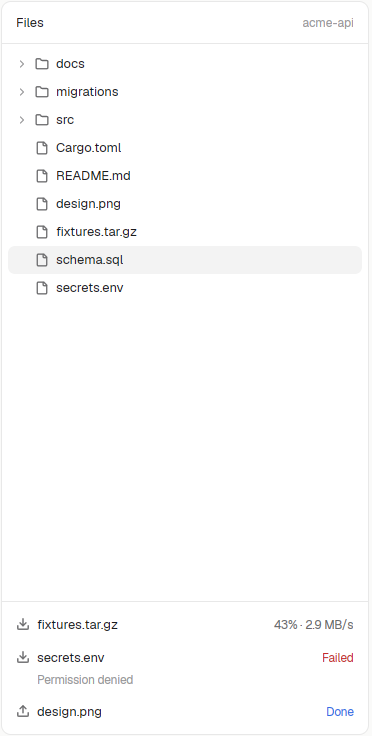

# agent-files

Herdr's Files panel, plus moving files between your computer and the machine a space runs on.
Right-click a file or folder to download it to `~/Downloads`; drop files from Finder on the
panel, or copy them in Finder and choose Paste, to upload them into that folder. Each transfer
gets one line with its progress, then Done or Failed and why. Copy path and Send path work on
any row.



## Install

```sh
git clone https://github.com/DeevsDeevs/deevs-herdr-kit
cp -R deevs-herdr-kit/agent-files/mods/agent-files ~/.config/herdr-app/mods/
herdr-app check ~/.config/herdr-app/mods/agent-files
```

Then point your layout's Files block at it: in `~/.config/herdr-app/layouts/<yours>.json`, the
block with `"id": "files"` keeps its id and gets

```json
"content": { "mod": "agent-files" }
```

(a shipped layout is cloned first: `herdr-app do layout.clone '{"name":"main"}'`). No keys.

Before you install, what it reaches for:

- The list is Herdr's own Files panel: `sh` lists a folder and `git status` marks changes, on
  this computer or through herdr-core on the space's machine.
- A transfer runs as its own herdr-core terminal on this computer (`hc run`, named
  `files-<id>`, labelled `agent-files=transfer`, no parent, removed when it ends), so it goes on
  when the panel closes or Herdr quits. It runs [transfer.sh](mods/agent-files/transfer.sh):
  `du -sk` for the size, `rsync -a --progress` over `ssh -o BatchMode=yes` to the machine's ssh
  target (`target` in `hc machine ls --json`), then `mv -n` to the first free name and `rmdir`.
  A failed or stopped transfer removes its own staging folder (`.agent-files-<id>`) with
  `rm -rf`, nothing else.
- Its state is in `~/.config/herdr-app/agent-files/transfers/<id>/` (`info.json`, `pid`, `log`,
  `err`, `status`); finished ones are deleted a day later, or when you choose Clear.
- Paste on macOS runs `osascript -l JavaScript` to read the files Finder put on the clipboard.
- Send path puts the path on the clipboard and runs Herdr's `terminal.paste`.

Needs `rsync` here and on the machine, an ssh login there that asks for nothing (keys or an
agent), and the machine added to hc with ssh (`hc machine add <host>`, not `--via`). macOS and
Linux.

## Use

- Right-click a file: Download, Copy path, Send path to the focused agent.
- Right-click a folder: Download, Paste (upload what you copied in Finder into it), Copy path,
  Send path. Right-click the empty part of the list for the shown folder.
- Drop files or folders from Finder on the list (into the shown folder) or on a folder row.
- Downloads go to `~/Downloads` on this computer. Nothing is ever overwritten: a taken name
  gets the next free one (`report 2.pdf`, `logs 2`).
- A file or folder shows under its name only once it is whole: it is copied into a hidden
  `.agent-files-<id>` folder beside it first, which the list leaves out.
- Right-click a transfer line: Copy path (where it landed), Clear.
- In a space on this computer, download and upload are plain copies.

## Limits

- A machine reached with `--via` can't transfer (its line says so); nor can an ssh target with a
  `:port` (use a `Host` alias in `~/.ssh/config`).
- A file name with `*`, `?` or `[` on the far side may confuse rsync's own matching there.
- Progress counts disk blocks (`du`), so a folder of many small files stays low until done.
- Send path leaves the path on the clipboard.

Icons from [Lucide](https://lucide.dev) (ISC, `LICENSE-Lucide.txt`); the panel is derived from
Herdr's shipped `files` mod (Apache-2.0, `LICENSE-Herdr.txt`).
