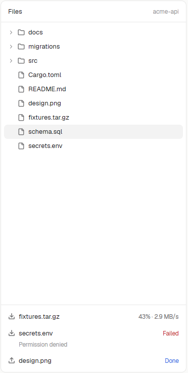

# Agent files

Herdr's Files panel that also moves files between the computer the app runs on and the machine
a space runs on, in both directions, with a line per transfer.

## What you see

The shipped Files panel, unchanged: a 42px header ("Files", the folder's name on the right),
the lazy tree (chevrons, `folder`/`file` icons, git marks), the read-only preview on click.
Folders named `.agent-files-*` are left out of the list.

- **Transfers**, under the tree when there are any: a 1px `border` on top, 6px padding, newest
  first, at most 176px tall and scrolling. Each line, 7px corners, `hover` background:
  - a Lucide `download` or `upload` icon (14px, `muted`), the name (truncated; once done, the
    name it got), and on the right at 11.5px: `45% · 2.9 MB/s` (`muted`) while it runs,
    `Done` (`done`), or `Failed` (`ansi1`);
  - a failed line has a second line, 11.5px `dim`, indented under the name: the reason, e.g.
    "Permission denied", "Could not resolve hostname box: Name or service not known",
    "Stopped".
- **Menu** on right-click, a popup of this mod (230px wide, 31px rows on `popover`, 14px icon
  in `muted`, ↑ ↓ Enter Esc), like Herdr's own menu:
  - a file: Download, Copy path, Send path to <program>;
  - a folder: Download, Paste, Copy path, Send path to <program>;
  - the empty part of the list (the shown folder): Paste, Copy path, Send path to <program>;
  - a transfer: Copy path (where it lands), Clear once it has ended.
  - Send path shows only when a terminal has focus on the same machine as the path;
    <program> is its program's name ("Claude Code", "zsh").

## How it behaves

- Download copies a file or a folder from the shown machine to `~/Downloads` here. Paste
  uploads what Finder copied into the folder (or the shown one); a drop from Finder on the list
  or on a folder row does the same.
- Never overwrite: the copy is made in `<folder>/.agent-files-<id>/` and moved to the first free
  name, `name`, then `name 2`, `name 3` (before the extension for a file, never for a folder or
  a dotfile), with `mv -n` (`mv -nT` where mv is GNU, so a folder that takes the name meanwhile
  never gets ours inside it). A half-copied file never shows under its real name. A link to a
  folder or a file copies what it points to; links inside a folder stay links. Other transfers'
  staging folders are never copied along (`--exclude`).
- Every transfer runs as its own hc terminal (`hc run --bg --rm --no-notify --no-parent --name
  files-<id> --label agent-files=transfer -- sh transfer.sh run …`): it outlives the render, a
  closed panel and a quit app, and exec's 10-minute limit. The panel only reads files.
- Its folder `<app home>/agent-files/transfers/<id>/`: `info.json` (written by the mod first:
  kind, name, src, dest, from, to, started), `pid`, `log` (`size <KiB>` from `du -skH`, then
  rsync's output), `err`, and `status` written last through a temp file ("done\n<name>" or
  "failed\n<stderr>"). `transfer.sh read` returns each with its log from an offset; ended ones
  over a day old are removed there.
- The panel reads every second while one runs, else every 10 s; one read at a time, its guard a
  time that lapses (a task Herdr cuts off never runs its `finally`). Over 64 KB of new log, `read`
  sends one line instead (bytes of finished files and du's size, summed by `awk`) and the last 20
  lines, so a read costs the panel little whatever the log's size. Progress folds each new
  piece of log into `{done, cur, rate, size}` in a module map, replaced whole.
- A menu's popup puts its job in a module queue and wakes the panel (`setShared`): the panel's
  task carries it out, since a closed popup's tasks are not relied on.
- Without a status: a dead pid is "Stopped", no pid after 30 s is "Did not start".
- When an upload ends the list reloads.
- Local space: both ends are here, rsync makes a plain copy.

## The route

rsync over ssh, started on the Mac (the servers can't reach it), to the machine's ssh target
from `hc machine ls --json` (`target`; `host` is the far core's own hostname, not an address),
`-o BatchMode=yes -o ConnectTimeout=15 -o ServerAliveInterval=15 -o ServerAliveCountMax=4` (a link
that goes silent ends the transfer within about a minute). Remote paths are quoted for the remote shell, and
`RSYNC_OLD_ARGS=1` makes an rsync 3 client pass them as they are, as openrsync always does.
Progress from `--progress`, both kinds:

- rsync 3: `      3,000,000 100%    2.76GB/s    0:00:00 (xfr#1, to-chk=0/3)`, updates start
  with `\r`;
- openrsync (macOS, protocol 29; `client.c` `rsync_progress`): ` %14llu %3.0f%% %7.2fMB/s
  hh:mm:ss`, then `\r`, or ` (xfer#N, to-check=i/n)\n` when a file ends; no rate under
  1 KB/s; no `--info=progress2`.

Percent: bytes of finished files plus the current one over `du`'s size, held at 99 until done.

## Built from

- Herdr's shipped `files` mod with the cut-off fix of herdr-app#1284 (loads time out instead of
  staying "loading"); its assets under `mods/agent-files/`.
- `herdr`: `exec`, `hc`, `appHome`, `home`, `writeTextFile`, `focused`, `terminals`, `run`
  (`terminal.paste`), `openOverlay`, `closeOverlay`, `props`, `setShared`, `window`.
  Elements: `on_mouse_down("right")`, `on_drop` (paths from Finder), `cx.read_from_clipboard`,
  `cx.write_to_clipboard`.
- The mod API reads only the clipboard's text, which for files copied in Finder is their names;
  on macOS Paste asks `osascript -l JavaScript` for the pasteboard's `public.file-url`s (Herdr's
  own `terminal.paste` reads them natively). Elsewhere, text lines that are absolute paths or
  `file://` URLs.
- No mod call types text into a terminal: Send path writes the quoted path (Herdr's rule for
  dropped paths, a space after it) to the clipboard and runs `terminal.paste`.
- `transfer.js` (no Herdr imports) and `transfer.sh`, tested by `node transfer.test.mjs` with an
  ssh stand-in (`$HC_SSH`, hc's own test hook).

## Done when

- `node agent-files/transfer.test.mjs` passes and `herdr-app check` passes on a copy.
- A file and a folder download from a remote space to `~/Downloads`; again, as `name 2`.
- Copied in Finder, then Paste on a folder row: they land in that folder; the list shows them.
- A drop from Finder on a folder row uploads into it.
- A running line shows its percent and rate; closing the panel and opening it again shows it
  still going, then Done.
- An unreadable file fails with "Permission denied"; nothing is left behind.
- Send path types the path into the focused agent without Enter.
