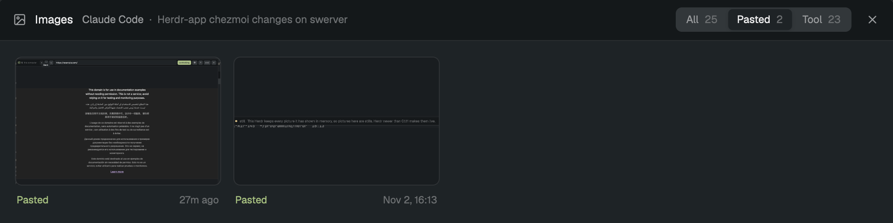

# agent-images

A [Herdr](https://herdr.dev) mod that shows the images in the focused agent's
conversation: Claude Code, Codex or pi, on this computer or on any machine Herdr reaches
through herdr-core. The agent itself only shows `[Image #4]`; here you see the picture,
hover it large, and copy it to paste into another agent.



## Install

```sh
git clone https://github.com/DeevsDeevs/deevs-herdr-kit
cp -R deevs-herdr-kit/agent-images/mods/agent-images ~/.config/herdr-app/mods/
herdr-app check ~/.config/herdr-app/mods/agent-images
```

Then bind it in `~/.config/herdr-app/keys.json` (see [keys.json](keys.json)):

```json
{ "global": { "ctrl-s i": "mod.open:agent-images" } }
```

Before you install, what it reaches for: it runs `hc get` for the focused terminal, then
`python3` with [extract.py](mods/agent-images/extract.py) on the agent's machine (here,
or through herdr-core on another one). The script reads that agent's transcript under
`~/.claude`, `~/.codex` or `~/.pi`, and finds it with `ps` and `lsof` (or `/proc`). The
images are saved under `~/.config/herdr-app/mods/agent-images-cache/`. Copy runs
`osascript` and `sips`, Open runs `open`: those two are macOS only.

Needs `python3` wherever the agents run.

## Use

- Focus an agent and press your key. The window follows whichever agent you focus.
- All · Pasted · Tool filters what you pasted apart from what tools produced.
- Hover an image to see it large; the copy button on it copies it.
- Click one to open it: `←` `→` step through, `⌘C` copies, `Esc` goes back, then closes.
- Paste a copied image into any agent with `⌘V`. Herdr uploads it for agents on other
  machines.
- It refreshes every 10 seconds, so a new paste shows up on its own.

Icons are from [Lucide](https://lucide.dev) (ISC, `LICENSE-Lucide.txt` beside them).
