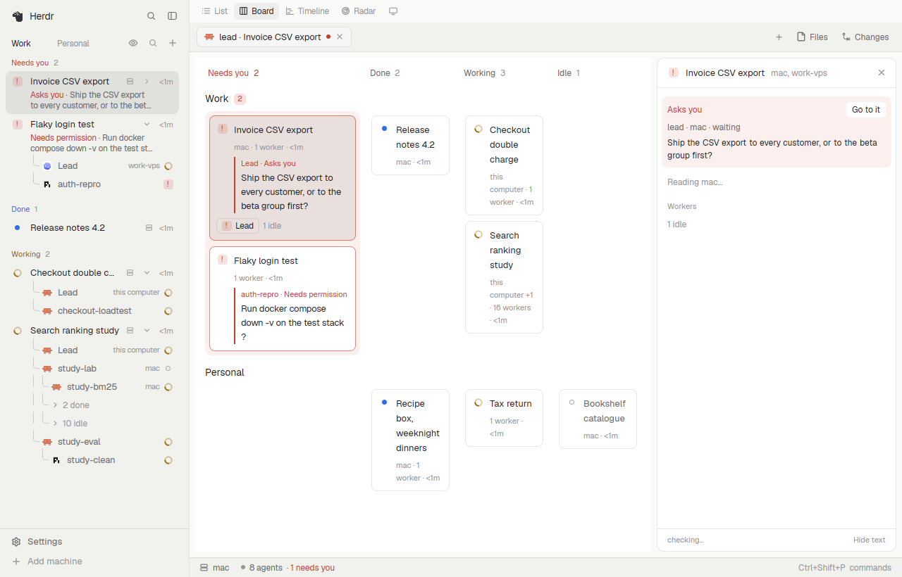

# agent-tower

A [Herdr](https://herdr.dev) sidebar that shows your work as tasks instead of terminals:
what needs you, what is done, what is working, on this computer and on every machine
herdr-core reaches. You start a task in a line of words; a lead agent plans it and starts
workers, and the panel beside the list shows where each task stands. Each area can have its
own Eye, one agent you tell what you want done there; it starts that area's leads and passes
messages on.



## Install

```sh
git clone https://github.com/DeevsDeevs/deevs-herdr-kit
cd deevs-herdr-kit/agent-tower
cp -R mods/agent-tower mods/agent-tower-panel ~/.config/herdr-app/mods/
cp layouts/*.json ~/.config/herdr-app/layouts/
herdr-app check ~/.config/herdr-app/mods/agent-tower
```

`tower` puts the list in the sidebar and Details in its own column; `tower-solo` lets Files
and Details take turns; `tower-wide` gives Details 420px; `tower-stack` puts Details under the
list. `tower-work`, `tower-personal` and `tower-investing` are areas' own windows (an area's
`layout`; see [examples/investing](examples/investing)); `tower-window` is the old whole-window
layout, still understood but no longer switched to. The start script for the Eye,
`tower-new`, `tower-adopt`, `tower-names` and `tower-eye` (below) ship inside the mod folder. Bind the window in `keys.json`
([keys.json](keys.json)): `{ "global": { "ctrl-s t": "mod.open:agent-tower" } }`.

Optional: the `tower` skill at `~/.agents/skills/tower/SKILL.md` on each machine where
leads run (without it a lead gets the same rules in its first message), and settings (below).

## Settings

`~/.config/agent-tower/config.json` (a Herdr with its own app home, such as a sandbox, reads
`<app home>/agent-tower/config.json` first). Every key is optional; a key in the wrong shape
falls back to its default and a toast names it.

- `agents`: what can be started, `[{ "id", "label", "argv" }]`. Default: Claude with Fable, Opus
  and Sonnet (`--permission-mode auto`), `pi`, and Codex (`codex --no-daemon`).
- `roles`: the default agent per role, by agent id: `eye`, `lead`, `worker` (default: Fable for
  the Eye and leads, Opus for workers); and `namer`, the command that names a new task (an argv;
  the task goes in after `-p`). A file may name just one.
- `areas`: `[{ "id", "label" }]`, plus per area:
  - `default`: true for the area shown first;
  - `machines`: hc machines whose tasks belong here (the first is where it "lives", so rows
    don't print it);
  - `layout`: its own window (a layout name, such as `tower-work`): switching to it switches
    layout;
  - `views`: the views it offers (`list`, `board`, `timeline`, `radar`, `watchlist`), the first
    where it opens;
  - `buttons`: recipe ids shown as buttons in its window;
  - `todo`: true keeps an empty Todo column for it in Board;
  - `eye`: its Eye, `{ "agent", "folder", "rules" }` (each optional: an agent id, where it
    starts, lines put first in its message after the global `eye.rules`), or `false` for an
    area without an Eye.
- `recipes`: what `+` starts, `[{ "id", "label", "area" }]`, plus `machine` (the hc machine for
  the lead), `folder`, `rules` (lines put first in the lead's message), `lead` and `worker`
  (agent ids), and the old `argv` (below).
- `eye`: for every area's Eye, `folder` (an area's Eye starts in `<folder>/<area id>`; default
  `<tower folder>/eye/<area id>`) and `rules` (lines put first in its message). Its agent is
  `roles.eye` unless the area names one.
- `taskRoot`: where a task lives when its recipe names no `folder`, at the top or per area
  (default `~/tasks`): `<taskRoot>/<slug>-<task id>`, the slug from the title or the first words
  typed, made on the lead's machine. A start whose folder can't be made is refused; a task never
  takes the shown space's folder.
- `skill`: the skill leads and the Eye follow (default `"tower"`); `null` sends the full rules
  (`contract`) in the first message instead.
- `contract`: those full rules, as text (`{id}` is the task id).
- `perf`: `true` appends one line per render (view, milliseconds, elements) and per command (its
  kind, milliseconds) to `<tower folder>/perf.jsonl`, no terminal text; past 1 MiB the file moves
  to `perf.jsonl.1`. Off by default.
- `doneSignal`: how another area shows a finish: `dot`, `pulse`, `line` or `off` (the
  right-click on the area row sets it too).

**Which agent starts.** A lead: the agent picked in the composer for that recipe ("Led by"),
else the recipe's `argv`, else its `lead`, else `roles.lead`. Workers: the recipe's `worker`,
else `roles.worker`. An area's Eye: the area's `eye.agent`, else `roles.eye`.

**An old file with `argv` in its recipes** still loads, but that `argv` wins over the recipe's
`lead` and over `roles.lead`: changing either does nothing for that recipe, and nothing says so.
Workers and the Eye don't read `argv`, and a pick in the composer still wins over it. To move
such a recipe to roles, delete its `argv` (and give it a `lead`, or let `roles.lead` decide).

The Eye on Codex, leads on Opus, workers on Sonnet:

```json
{ "roles": { "eye": "codex", "lead": "claude-opus", "worker": "claude-sonnet" },
  "areas": [ { "id": "work", "label": "Work", "machines": ["vps"] },
             { "id": "personal", "label": "Personal", "default": true } ],
  "recipes": [ { "id": "vps-lead", "label": "Lead on vps", "area": "work", "machine": "vps" },
               { "id": "home-lead", "label": "A lead here", "area": "personal" } ] }
```

## What it reaches for

- **This computer:** `hc machine ls`, `label`, `kill`, `rm`, `ls --all` and `send` (to the
  shown area's Eye, only what you type; never `--force`); `claude -p --model haiku` to name a new task
  (`roles.namer`); `mkdir`, `ls`, `date`, `rm` on `~/.config/agent-tower/inbox` and
  `outbox`, which `tower-new`, `tower-adopt`, `tower-names` and `tower-eye` write; `grep -qx '## Eye'` on the tower skill before
  starting the Eye; Herdr's `knownAgents()` for the picker's icons; `open` or `xdg-open`
  for a pull request link; `sh -c 'mkdir -p … && printf … >> …'` to append a line to
  `~/.config/agent-tower/use.jsonl` when you switch a view, shape or variant; `mkdir` and
  `hc read <agent> --lines 18` for Timeline's record (above). It reads
  `~/.config/agent-tower/config.json` (else `~/.config/agent-tasks/`).
- **Herdr:** `terminal.pin` (Pin to the top), `terminal.keep` and `space.select` (Keep),
  `space.rename` and `tab.rename` (names, each after an `hc label` of `tower.space-name` or
  `tower.tab-name` on a terminal in it), and `hc label <worker> herdr.space=… herdr.tab=…` to give a worker on
  another machine a space of its own there.
- **The machine a task's lead runs on:** before a start, one small script per worker agent,
  `~/.config/agent-tower/bin/worker-<agent id>` (`exec <the agent's argv> "$@"`), which the lead
  gets as `$TOWER_WORKER`, so an argv with quotes in it reaches workers intact.
- **The machine a task runs on:** `sh -c 'test -f "$HOME/.agents/skills/$1/SKILL.md"' sh
  tower` once per session, and for the panel `python3` with
  [read.py](mods/agent-tower-panel/read.py), which reads
  the lead's and workers' transcripts under `~/.claude`, `~/.codex` or `~/.pi` (found with
  `ps` and `lsof` or `/proc`), runs `git` in their folders, `gh pr view` there when `gh` is
  installed, and `node ~/.agents/skills/chains/chain.mjs` for the newest chain link.
- **Starting:** new spaces with the recipe's agent (default `claude --model fable
  --permission-mode auto` for leads and the Eye; workers `claude --model opus`). Nothing starts by itself, the Eye included. Closing ends only
  the terminals the question counted, and nothing at all if a machine does not answer.

## Use

- `+` opens the composer: pick the area's Eye or one of its recipes, type, Enter. The agent after "led by"
  picks who leads. "New space" beside them is Herdr's own new space (its ▾: on which machine).
- A row is a task, on every machine it runs on. Click it to select it (Details follows);
  click its lead or a worker under it to open that terminal. Right-click for Details, Pin to
  the top, Rename, New lead, End.
- **New lead** gives a task a fresh lead in a new tab of its space and folder, as the same task.
  The old lead stays as a worker while its agent runs, else as a plain shell. A row whose lead
  ended says "lead ended". With a task selected, the composer's "in <title>" chip starts a lead
  or a worker inside it instead of a new task.
- The magnifier (`ctrl-s /`) searches every task, agent and machine in every area.
- The eye icon in the header starts the shown area's Eye (in the whole window, the icon in the
  bar); right-click the Eye to end it.
- A right-click on the area row flips the variants (how "done in another area" shows, what
  stands at the left of a task); each flip is logged in `~/.config/agent-tower/use.jsonl`.
- Narrow the sidebar below 160px for the rail.
- A row that isn't a task yet has "Make a task" in its right-click menu.
- A space made with the list's "New space" is a task from birth: titled with the space's name, in
  the area shown. An agent you open later in one of its tabs joins it as a worker.
- Earlier lists its tasks A–Z, one line each.
- Herdr's own screens name a task's space after its title and its tabs lead, a worker's name,
  shell or Eye. A new task's space is "New task" with a "lead" tab until the namer's title
  comes (if the namer fails, until a Rename). A space still carrying Herdr's own name (its folder's) takes its task's title at
  once; only a name someone typed is kept. `tower-names` shows what it would rename
  (`--apply` does it; `--named` also replaces names you typed).
- `tower-eye status|start|end [--area <id>]` shows, starts or ends an area's Eye without a click.

## The Eye

One Eye per area, started by hand: its icon, or `tower-eye start` (nothing starts by itself). The list shows and talks to the
shown area's Eye only: its row above the area row, the composer's Eye chip, the start icon and
End. A waiting Eye counts in its area's red number. It runs on this computer in a space
"Eye · <area>", labelled `tower.eye=1` and `tower.area=<area id>`, with `TOWER_AREA` in its
environment beside `TOWER_NEW` and `TOWER_CONFIG`.

An Eye gives a task whose lead ended a fresh one with `tower-new --task <id> <recipe id>
"<words>"` (`--as worker` adds a worker instead), never a new task.

An Eye keeps to its area by its rules and one check, not by a wall:
- **Checked:** `tower-new` sends the Eye's area with the request, and Agent Tower refuses a recipe
  of another area. An agent that unsets `TOWER_AREA` or writes the request file itself gets past
  it.
- **Rules only:** `hc ls --json` shows every terminal on every machine, and `hc send` reaches any
  of them. The skill tells an Eye to look at and message its own area's tasks only, and to send
  work for another area back to you.

An Eye started before Eyes were per area (no `tower.area`) still works: it shows in every area
that has no Eye of its own and doesn't say `eye: false`, until you end it. Each area keeps the
words you typed for its Eye, and an Eye's space never shows as a space row.

## Old spaces as tasks: tower-adopt

`tower-adopt` sits beside `tower-new` in the mod folder; Agent Tower must be showing.

- `tower-adopt` is a dry run: one line per space, and nothing changes.
  `name [space id] (machine, quiet 3d) → "title" in area: lead t4, workers t5 t6`, or why the
  space is left alone (it already hosts a task, nothing in it is live, it is the Eye's).
- `tower-adopt --apply` makes every space it can into a task, by labels only: no agent is started,
  stopped or messaged. Run again, it changes nothing.
- One space is one task, titled with the space's name. A home-folder name (`~`, your user name,
  `Downloads`) takes the lead's own title instead. No two tasks share a title: a clash adds the
  other machine's name, else a number. The area comes from the machine. The lead is the space's
  first agent (first tab, first pane); its other agents are workers. A plain shell belongs to the
  task quietly. Finished terminals are left alone.
- One space at a time, by hand:
  `tower-adopt [--apply] --space <id or name> [--title <words>] [--lead <address>] [--area <id>]`.
  The id is on each line of the dry run; a name several spaces share needs the id. The lead must
  be a live terminal of that space. A dry run with the same flags shows exactly what `--apply`
  will do.

## Views

The view switch changes what the centre shows, without restarting anything or losing the
selection: **List** (the terminals, as before), **Board** (every area at once, a column per
state), **Timeline** (each task's agents over time) or **Radar**. Keys: `ctrl-s s`, `ctrl-s o`,
`ctrl-s g`, `ctrl-s r` (and `ctrl-s v` for a watchlist where an area has one). Where the switch
sits is a variant (right-click on the area row): a bar above the centre (the default), one icon
in the list's header, or a row at the foot of the list. The monitor icon lets a view take the
whole window by hiding the list; the same icon brings it back. A task clicked in a view opens it
on the list's screen, and "‹ Board" goes back. Every view draws from the same model, marks and
words.

**Areas.** Clicking an area, or `ctrl-s a` for the next one, opens that area's own window when its
settings name a `layout` (the one moment Herdr restarts the mods), offers only its `views`, and
shows its `buttons` (recipes). Each area comes back on what it was left on: its view, its shape,
its selected task and the terminal in front, and the list's folds; an area visited for the first
time opens on its first task, Needs you first. Words typed in the composer come back too. Lost on
an area switch: a peek or the search that was open, scroll positions, and about half a second of
redraw.

Every switch of a view, a shape or a variant is appended to `~/.config/agent-tower/use.jsonl`
with its time and whether a click or a key made it, and `use.md` beside it sums it up: how often
each was chosen and, as an estimate, how long each view was on screen (counted only while the
Herdr window was in front).

### Timeline: what it keeps, and what it cannot know

The list records every change of an agent's state to `~/.config/agent-tower/timeline/` (in the
whole-window shape, where the list is hidden, the view's own copy does):
- `events.json`: states, where you looked and gaps, the last 2 days (7 until the first hourly move);
- `screens.json`: the last 18 lines of an agent's screen when it stopped, asked or finished, 26 hours;
- the long past, moved out of `events.json` once an hour:
  - `tasks/<task>.json`, one file per task, thinned with age. Past 7 days, working stretches
    under 10 minutes apart merge and messages keep 120 characters; past 30 days, under an hour
    and 60 characters. Where you looked stays exact for 7 days, then one per agent per hour.
  - `index.json` names the task files.
  - `ended.json`: 90 days after a task ended, its file goes and one line stays (title, area,
    from and to, agents, asks, time working, longest ask), kept a year.
  - The folder stays under 25 MiB: past it, old looks go first, then ended tasks fold into
    `ended.json` (oldest first), then live tasks thin a step further (oldest first).

They stay on this computer. `screens.json` holds what your agents printed, and the task files
keep their asks and Done messages cut short, so treat them like their transcripts. Timeline draws what was not recorded as a grey band, never as a quiet agent:

- **Before you installed it**, nothing. An agent already running gets "Before recording" up to
  the moment the list first saw it.
- **While Herdr is closed or the computer sleeps**, no one watches. hc keeps running, so when you
  come back each agent's state and since when are right, but changes in between are lost, and
  so are agents that ended and were removed meanwhile.
- **While a machine does not answer**, nothing from it. After it comes back, the time of a change
  there is when Herdr saw it.
- **A layout without agent-tower** records nothing, because Herdr has no background mod. Every
  agent-tower layout has it.
- **Faster than a redraw:** an agent that asks and is answered within a second or two may not show.
  Its screen is read just after the change, not at it.
- **Where you looked** is focus inside Herdr with its window in front. Reading an agent elsewhere
  doesn't count, and what you typed is never recorded.

Words: an **Eye** is an area's agent you tell what you want; an **area** is Work or Personal; a **task**
is one piece of work; its **lead** plans and delegates; **workers** do the parts; a
**recipe** says where and with which agent a lead starts.
